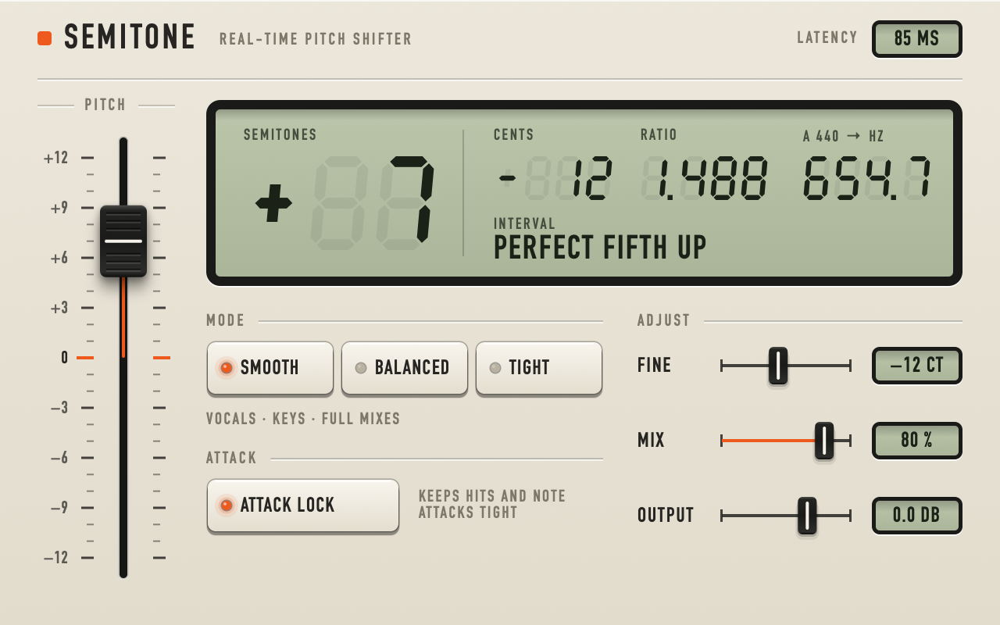

# Semitone

A real-time pitch shifter plug-in for macOS and Windows (VST3, Audio Unit, standalone).
±12 semitones plus fine tuning in cents, constant latency, exact stereo image.



## Install

Download the zip for your system from the [Releases](../../releases) page. Each zip has an
`INSTALL.txt` with where to put the files.

The builds are not signed. On macOS that means clearing the quarantine flag once after
download (the command is in `INSTALL.txt`).

## Controls

| Control | What it does |
| --- | --- |
| Pitch fader | Pitch in semitones, −12 to +12. Double-click to return to 0. |
| Display | Semitones, cents, the pitch ratio, what A 440 becomes, and the interval name. |
| Mode | **Smooth**: longest window (85 ms at 48 kHz), cleanest on vocals, bass, keys, pads, full mixes. **Balanced**: 43 ms. **Tight**: 21 ms, for drums and percussion; it cannot separate low notes that sit close together, so keep bass and chords out of it. |
| Attack lock | Re-anchors drum hits and note attacks so they stay tight instead of smearing. Leave on; turn off to compare. |
| Fine | −100 to +100 cents on top of the fader |
| Mix | Dry/wet. The dry signal is delayed to line up with the shifted one. |
| Output | Output level, −24 to +12 dB |

Latency equals the window length and is reported to the host, so tracks stay in time.
It changes when you change Mode.

## How it works

`Source/PitchEngine.h` is the whole engine, with no dependencies. Per overlapping frame it
finds the spectral peaks, measures each one's true frequency, moves each peak and the bins
locked to it to the new pitch, and keeps the phase of every partial continuous from frame
to frame. When a partial's level jumps (an attack), its phase is re-anchored to the moment
the attack starts, which is what keeps transients tight. The same map is applied to every
channel, so the stereo image is preserved exactly. The comment at the top of the file has
the details.

## Build

Needs CMake 3.22 or later and a C++17 compiler: Xcode command line tools on macOS, Visual
Studio 2022 on Windows. JUCE 8.0.4 is downloaded by CMake on the first configure (or put a
checkout in `JUCE/` to use that instead).

```bash
cmake -B build -DCMAKE_BUILD_TYPE=Release
```

```bash
cmake --build build --config Release --parallel
```

Results land in `build/Semitone_artefacts/Release/`. To also copy the plug-ins into your
plug-in folders, configure with `-DSEMITONE_INSTALL=ON`.

## Tests

```bash
ctest --test-dir build -C Release --output-on-failure
```

- `engine` measures the pitch engine on its own: pitch accuracy, residual noise, click and
  drum-hit smearing, stereo image, CPU. Run `SemitoneEngineTest <folder>` by hand to also
  render demo WAVs into that folder.
- `plugin` runs audio through the processor, renders the UI to `build/ui*.png`, and loads
  the built VST3 the way a host does.

Both run on macOS and Windows in CI on every push.

## Licence

Semitone is free software under the [GNU Affero General Public License v3.0](LICENSE).
It is built with [JUCE](https://juce.com), which is used here under the same licence.
